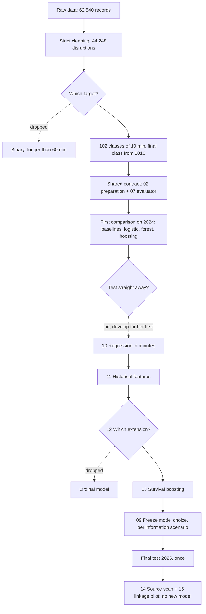

# Process — from raw data to final test

Last update: 13 November 2026. For: anyone taking over the project (report,
presentation, code submission). Read this document first, then
[HANDOVER.md](HANDOVER.md) for exact numbers, limitations and what still needs doing.

This document tells **the story**: which steps we took, where we took a
**decision point** (dropped an earlier plan or chose between alternatives),
**why**, and **what it led to**.

---

## 1. At a glance

**Question.** At the start of a train disruption, predict how long it will last,
as a probability distribution over 102 ten-minute intervals (the last one: ≥ 1010 min).

**Data.** Rijden de Treinen, 2011–2025. From 62,540 raw records to 44,248 selected
domestic disruptions. Training 2011–2023 (33,004), validation 2024 (5,296),
test 2025 (5,948).

**Final test result (2025, opened once).** Lower log loss is better.

| Information at prediction time | Chosen model | Log loss | Baseline | Exact class |
|---|---|---:|---:|---:|
| Time features only | Survival boosting, trained from 2017 | 3.1620 | 3.2065 | 10.93% |
| Archived context (cause, route) | Random forest | 3.0189 | 3.0273 | 12.02% |

Both models beat their baseline, but the gain is modest. Precise end times cannot
be predicted reliably: the 80% intervals of the context model are on average
almost 223 minutes wide.

**Folder order ≠ execution order.** Folder numbers were assigned before we knew
which extra experiments would follow. The actual order was:

```
Data Cleaning → 01 → 02 → 07 → 03 → 04 → 05 → 06 → 08
             → 10 → 11 → 12 → 13 → 09 (final test) → 14 → 15
```

Folder names are partly Dutch (`moddeling`, `voorbereiding`, `foutanalyse`, …).
They were kept on purpose because scripts refer to them. See the glossary in
[`AGENTS.md`](../AGENTS.md).

---

## 2. The whole route as a diagram



---

## 3. Phase by phase

For each phase: **what** we did, the **decision point** (if any), **why**, and the
**consequence**. Folder names refer to `moddeling/` unless stated otherwise.

### Phase 0 — Exploring the data (8–11 November)

- **What:** Jesse supplied the raw data and a first cleaned version; Mart made a
  descriptive analysis of the raw data (`descriptive data analysis/`).
- **Key finding:** all 12,150 records with more than one minute difference between
  reported and calculated duration are before 2017. The source documents a
  registration change in 2017.
- **Consequence:** this quality break around 2017 returns as a training-period
  sensitivity (decision 5, phase 7).

### Phase 1 — Cleaning (`Data Cleaning/`)

- **What:** one reproducible script (`clean_disruptions.R`) with 12 filters.
  From 62,540 to 44,248 records. Largest filters: duration difference > 1 minute
  (11,031), foreign route (5,078), unclassifiable route (999), duration > 24 hours (344).
  Details per filter: `Data Cleaning/output/cleaning_report.md`.
- **Decision 1 — exclude strictly instead of repairing.**
  - *Alternative:* correct inconsistent durations or keep international routes.
  - *Chosen:* exclude, never invent. The raw data stay untouched.
  - *Why:* a corrected duration would be an invented label, while duration is exactly what we predict.
  - *Consequence (limitation!):* mainly early years are thinned out, and disruptions
    > 24 hours are removed based on their **final** duration. At onset you cannot
    know that yet. Results therefore hold for this selection, not for all disruptions.

### Interlude — How the dataset changed (during the project and across years)

**Versions during the project.** The raw data were never changed (MD5 `757d2c2a…`).

| Version | When, by whom | Rows | What |
|---|---|---:|---|
| Raw | 8 Nov, Jesse | 62,540 | Source file from Rijden de Treinen |
| Clean v1 | 8 Nov, Jesse (commit `824f678`) | 61,602 | Only 827 zero durations and 111 missing durations removed. The script that produced it is **not** in the repository |
| Clean v2 (current) | 11 Nov, Oliver (commit `a78d13c`) | 44,248 | Strict cleaning, 12 filters (phase 1). A strict subset of v1 |

Numbers such as "61,602 disruptions" or "50.7% long" in old notes belong to v1.
All models use v2 (MD5 `6f22afc6…`).

**Differences between years** (source: `Data Cleaning/output/yearly_profile.csv`,
produced by `Data Cleaning/yearly_profile.py`):

| | 2011–2016 | 2017–2025 |
|---|---|---|
| Retained after cleaning, per year | 5–16% | 83–93% |
| Rows in clean data | 1,715 (5% of training) | 42,533 |
| Median duration | 86–158 min | 42–72 min |
| Share > 60 minutes | 61–88% | 40–55% |
| Largest cause group | Infrastructure (33–49%) | Rolling stock (37–51%) |

- **Before 2017 it is a different population.** Because of the 2017 registration
  change, early records drop out massively on the duration check. What remains is
  mostly a selection of longer infrastructure disruptions. This explains why
  training from 2017 works better for the time-only model (phase 7), and it is the
  concrete form of the selection bias from decision 1.
- **Unknown cause is rising again.** The share of `unknown` was below 1% in
  2019–2022, but 4.6% in 2024 and 5.1% in 2025: exactly the validation and test
  years. The context model therefore gets no cause more often there.
- **From 2018 the data are fairly stable:** median duration 42–56 minutes per year.
  2017 itself (72 minutes) is a transition year.

This is descriptive: it shows *that* years differ, not *why* the disruptions
themselves changed. Registration, selection and real change are mixed together.

### Phase 2 — Plan, target and metric (11 November)

The original proposal (meeting of 11 November) was a **binary** prediction: will the
disruption last longer than 60 minutes? With a 3:1 cost ratio for missed long
disruptions, PR-AUC/AP as the metric, and training from 2017.

- **Decision 2 — from binary to ten-minute classes.**
  - *Alternative:* binary > 60 min (in the supplied project text).
  - *Chosen:* ten-minute classes, first with a final class ≥ 120 min.
  - *Why:* an explicit project choice by Oliver to predict an interval instead of
    just long/short. The original assignment (`Project.pdf`, Part B) does not require
    a binary target; that was only in our own earlier text.
  - *Consequence:* a much harder problem. Low exact accuracy (~12%) is expected here
    and is not comparable to binary accuracy. Report sections B1/B3 must be
    consistent with this.

- **Decision 3 — final class from ≥ 120 to ≥ 1010 minutes** (`01_target/`).
  - *Alternative:* ≥ 120 min, but that class held 28.1% of training.
  - *Chosen:* extend the ten-minute classes until the final class is about as large
    as an average class: cutoff 1010 min, 322 rows (0.98%) versus 323.6 on average.
  - *Why:* a 28% final class hides exactly the long disruptions. The cutoff was set
    on training data only.
  - *Consequence:* 102 classes, strongly imbalanced (61 classes have < 50 examples).

- **Decision 4 — metric: log loss instead of costs/PR-AUC.**
  - *Why:* with 102 classes no single threshold or PR curve fits. Log loss judges the
    whole probability distribution. Accuracy, macro-F1, "within one class" and later
    RPS are secondary.
  - *Consequence:* the winner need not be the model with the highest accuracy
    (see decision 10).

- **Decision 5 — training period: 2011–2023 as the main variant.**
  - *Alternative:* the proposal to train only from 2017.
  - *Chosen:* 2011–2023 (as in the supplied text), with 2017–2023 as a sensitivity check.
  - *Consequence:* in phase 7 the 2017 variant turned out better for the time-only
    model, and it was chosen.

- **Decision 6 — two information scenarios instead of one model.**
  - *Why:* the dataset stores the **last** cause and the **final** route. These can
    be changed after onset. A model using them may look better than it would be live.
  - *Chosen:* every model twice: **time-only** (hour, weekday, month, weekend,
    rush hour) and **archived context** (plus cause group, route and station
    counts, hubs, top-20 routes).
  - *Consequence:* two winners, one per scenario; they are not direct competitors.
    Phase 9 confirms the concern: in 5 of 40 examined disruptions the cause changed.

- **Other fixed agreements:** language R; seed 42; chronological splits (no random
  folds); tuning on forward folds (through 2021 → 2022 and through 2022 → 2023);
  2025 is opened only when everything is frozen. Division of work: Mart the shared
  basis, baselines and logistic regression; Oliver the tree models, error analysis
  and follow-up.

### Phase 3 — Shared contract (`02_voorbereiding/`, `07_evaluatie/`) — Mart

- **What:** one `prepare_data()` and one `evaluate_predictions()` used by every model.
  Preprocessing is learned on training only, refitted per fold. Fixed column order
  for the 102 probabilities. Boundary checks at 9, 10, 19, 20, 1009, 1010 and 1440
  minutes. Duration, end time and statistical cause are never predictors.
- **Why:** this way every model is scored on exactly the same rows and labels.
- **Check:** 156 automated checks (steps 02, 03, 04, 07) passed on 11 November.

### Phase 4 — First model comparison (`03`–`06`, `08`)

- **What:** Mart: global and cause-group baseline (03), multinomial ridge logistic
  regression (04). Oliver: probability random forest (05), multiclass XGBoost (06),
  error analysis (08). Small fixed grids, chosen on the forward folds.
- **Result on validation 2024 (log loss):**

  | Model | Time-only | Archived context |
  |---|---:|---:|
  | Baseline (global / cause) | 3.2309 | 3.0716 |
  | Logistic regression | 3.2173 | 3.0820 |
  | Random forest | **3.2139** | **3.0591** |
  | XGBoost | 3.2195 | 3.0844 |

- **Consequence:** forest wins both scenarios, but the margin over the baseline is
  small. Cause is by far the most important feature group. The context model
  underestimates the class in 81% of cases.

### Phase 5 — Decision 7: do not test yet, develop further first

- *Alternative:* freeze forest and test on 2025 straight away.
- *Chosen:* development experiments first (phases 5–7), all on training/validation
  only. The test stayed closed.
- *Why:* the gain over the baseline was small and exact accuracy low. While the test
  is unused, we can still check whether another formulation (minutes) or extra
  information (history) helps.
- *Price:* 2024 was used repeatedly and is therefore **not an independent test**
  anymore. The report must say so.

**Experiment 1 — regression in minutes (`10_regressie_experiment/`).**
Direct duration prediction with XGBoost (absolute error). Context MAE 68.06 min
versus 78.77 for the median baseline. But exact-class accuracy was 9.25%, lower
than forest (12.31%).
→ **Not adopted.** MAE and log loss are different yardsticks; this does not replace
the classifiers, but it is a supplementary finding.

**Experiment 2 — historical features (`11_historische_kenmerken/`).**
Counts of earlier disruptions and median duration of earlier completed disruptions
(national, per route, per cause), strictly using information from before the moment.
Context MAE 68.06 → 68.95: no gain; the bootstrap interval includes zero.
→ **Not adopted.** A negative result, honestly documented. It does not prove that
all historical information is useless.

### Phase 6 — Decision 8: which extension? Ordinal → survival (`12`, `13`)

- **Step 12** proposed an ordinal model (the classes have an order).
- *Then:* we re-read the original assignment. It asks for at least three suitable
  models, justified evaluation, error analysis and model choice, but no specific
  algorithm. More complexity does not automatically earn a higher grade.
- *Chosen:* one focused technical extension: **discrete-time survival** with XGBoost
  instead of a separate ordinal model.
- *Why survival:* for each interval the model asks "if the disruption has lasted
  until here, what is the chance it ends now?". That uses the order of the intervals,
  shares information between classes and naturally yields consistent recovery
  probabilities ("chance resolved within 60 min") and uncertainty intervals. The
  output is again the same 102 probabilities, so it is directly comparable.
- *Consequence:* step 12 is kept as a record of the discussion, but its ordinal
  advice is superseded.

### Phase 7 — Survival and training period (`13_survival/`)

Survival was trained on 2011–2023 and, as a sensitivity check (decision 5), from 2017.

| Validation 2024 (log loss) | Time-only | Archived context |
|---|---:|---:|
| Random forest | 3.2139 | **3.0591** |
| Survival 2011–2023 | 3.1935 | 3.0678 |
| Survival 2017–2023 | **3.1905** | 3.0627 |

- **Time-only:** survival from 2017 wins clearly (bootstrap interval of the
  difference with forest: −0.0332 to −0.0141).
- **Context:** forest stays just ahead; the difference is small and uncertain
  (interval includes 0).
- **Uncertainty:** 80% intervals cover ~90% of outcomes, but are ~214 minutes wide on average.

### Phase 8 — Decisions 9 and 10: freeze the model choice and test once (`09_modelkeuze_en_test/`)

- **Decision 9 — choose per scenario, not one winner.** Time-only: survival from
  2017. Context: random forest. Each compared with a baseline from the same
  training years.
- **Decision 10 — choose on log loss, not accuracy.** Logistic regression had the
  highest exact context accuracy (12.76%), but the metric was fixed in advance as
  log loss. Switching metrics afterwards would amount to "picking what looks best".
- **No retraining on 2024.** The test scores exactly the chosen models.
- **Test protocol** (`TEST_PROTOCOL.md`): hashes of code, data and models recorded;
  2024 predictions rebuilt as a check; 2025 predictions saved **before** the labels
  were read; then scored once. The file `TEST_OUTCOMES_OPENED.txt` blocks a second
  run. Do not delete it.
- **Outcome:** see the table in §1. Both models beat their baseline; the forest gain
  is small (bootstrap −0.0151 to −0.0012). For "resolved within 60 or 120 minutes"
  forest is even slightly worse than the cause baseline (Brier). The test outcome
  determines how strong the conclusion is, not which model wins.

### Phase 9 — After the test: could better information help? (`14`, `15`)

- **Decision 11 — no new model, feasibility first.**
  - *Why:* the biggest weakness is that the context (cause, route) may have been
    changed afterwards. Better information at onset could help more than a new
    algorithm. But 2025 has been used, so an enriched model has no independent test left.
  - **Step 14:** searched public sources (NS/NDOV message archive, KNMI weather,
    stations). Research only, nothing linked.
  - **Step 15:** pilot on three pre-chosen days (10 November 2017, 2020, 2023).
    40 of 42 disruptions could be linked to their first NS message.
- **Two findings directly relevant to the report:**
  1. Our `start_time` lies a median of 1 second after the first public NS message.
     We are therefore effectively predicting **at the moment of the first public
     message**, not at the physical start of the incident.
  2. In 5 of the 40 the first cause differs from the final one (3 substantively,
     e.g. "unknown cause" → "defective train"). Concrete evidence for decision 6.
- **Consequence:** a recommendation for follow-up research, not a model result.

---

## 4. All decision points summarised

| # | Moment | Dropped | Chosen | Why | Consequence |
|---|---|---|---|---|---|
| 1 | Cleaning | Repair inconsistent data | Exclude strictly | No invented labels | Selection bias: early years and > 24 h removed |
| 2 | Target | Binary > 60 min | Ten-minute classes | Project choice; binary not required | Hard problem, low exact accuracy |
| 3 | Target | Final class ≥ 120 (28%) | Final class ≥ 1010 (1%) | Keep long disruptions visible | 102 imbalanced classes |
| 4 | Metric | Costs 3:1, PR-AUC | Log loss | Judges the whole distribution | Winner ≠ highest accuracy |
| 5 | Period | Only from 2017 | 2011–2023, 2017 as sensitivity | Supplied text; test 2017 separately | 2017 variant wins time-only |
| 6 | Features | One model with all info | Time-only and archived context | Cause/route can change afterwards | Two winners; context not proven live |
| 7 | After step 08 | Test straight away | Development experiments first | Small gain; test usable only once | 2024 no longer independent |
| 8 | Extension | Ordinal model | Survival | Fits the assignment; consistent probabilities + uncertainty | Best time-only model |
| 9 | Choice | One winner | One per information scenario | Scenarios are not comparable | Two models tested |
| 10 | Choice | Logistic (highest accuracy) | Lowest log loss | Metric fixed in advance | Forest for context |
| 11 | After test | Build an enriched model | Feasibility pilot only | 2025 already used; show coverage first | Recommendation, no claim |

---

## 5. What was cleaned up (13 November) and where it is now

Superfluous and outdated files were removed for the handover. Nothing of substance
was lost: agreements and decisions are in this document, numbers in the output
folders, old versions in the git history.

| Removed | Why | Content is now in |
|---|---|---|
| `docs/parallel_modelling_plan.md` | Work plan of 11 November; status outdated | Phases 2–4 above. Original: commit `6b4060e` |
| `docs/B5_meeting_preparation.md` | Binary proposal, superseded (decision 2) | Phase 2 above |
| `moddeling/00_afspraken/` | Empty template README, never filled in | Phase 2 above |
| `moddeling/publication_verification.md` | Stand-alone verification note | Phase 3 above (156 checks); commit `2979790` |
| `report_section_5.md` (steps 04, 05, 06, 08), `report_section_B5.md` (13), `presentation_outline.md` (08) | Interim draft texts, each with an outdated status | One current text: `09_modelkeuze_en_test/output/B5_FINAL_REPORT_TEXT.md` |
| `04_logistic_regression/write_report.R`, `08_foutanalyse/write_reports.R` | Generated those drafts; `write_reports.R` also **overwrote** the READMEs of steps 05, 06 and 08 on every rerun | READMEs are now maintained by hand |
| `disruptions_cause_different_or_na.csv` (root) | Stray ad-hoc export, used by nothing | Can be rebuilt from the clean data |
| `15_koppelpilot/output/sample_manifest.json` and the `--sample-only` option | One-off test download before the pilot | `download_manifest.json` |
| `__pycache__/` | Python cache | Created automatically; in `.gitignore` |

Also on 13 November: all documentation was translated to English. The Dutch files
`docs/PROCESVERLOOP.md` and `docs/OVERDRACHT_MODELLERING.md` were renamed to
`docs/PROCESS.md` and `docs/HANDOVER.md`.

Deliberately **not** removed: `12_modelstrategie/` (documents decision 8), the
negative experiments 10 and 11 (part of an honest report) and every output file
read by the final test or the independent checks.

---

## 6. What still needs to happen

1. **Report** (max. 5 pages excl. appendix): start from
   `moddeling/09_modelkeuze_en_test/output/B5_FINAL_REPORT_TEXT.md`. Include at least
   three model families from validation (phase 4), not only the two tested ones.
   Describe the prediction moment as "at the first public message" (phase 9).
2. **Presentation** (max. 10 slides): outline in the handover, §8.
3. **Code submission:** the repository as it is, with the root README as entry point.
   Do not reopen 2025 for model selection.
4. **Pull request** from branch `Oliver` to `main`, reviewed by Mart.

AI assistance was used for code, analysis and documentation. The group must be able
to explain the choices and results themselves.
