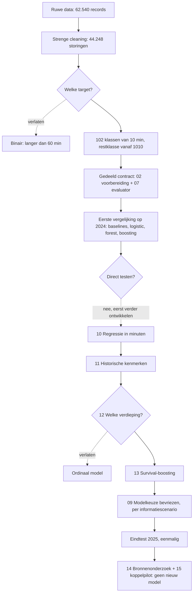

# Procesverloop — van ruwe data tot eindtest

Laatste update: 13 november 2026. Voor: iedereen die het project overneemt
(verslag, presentatie, code-inlevering). Lees dit document eerst; daarna
[OVERDRACHT_MODELLERING.md](OVERDRACHT_MODELLERING.md) voor exacte cijfers,
beperkingen en wat er nog moet gebeuren.

Dit document vertelt **het verhaal**: welke stappen we namen, waar we een
**afslag** namen (een eerder plan loslieten of een keuze maakten tussen
alternatieven), **waarom**, en **wat dat opleverde**.

---

## 1. In één oogopslag

**Vraag.** Voorspel bij het begin van een treinstoring hoe lang die gaat duren,
als kansverdeling over 102 tijdvakken van 10 minuten (de laatste: ≥ 1010 min).

**Data.** Rijden de Treinen, 2011–2025. Van 62.540 ruwe records naar 44.248
geselecteerde binnenlandse storingen. Training 2011–2023 (33.004), validatie
2024 (5.296), test 2025 (5.948).

**Uitkomst op de eindtest (2025, eenmalig geopend).** Lagere log loss is beter.

| Informatie bij voorspelling | Gekozen model | Log loss | Baseline | Exact goed |
|---|---|---:|---:|---:|
| Alleen tijdkenmerken | Survival-boosting, getraind vanaf 2017 | 3,1620 | 3,2065 | 10,93% |
| Opgeslagen context (oorzaak, traject) | Random forest | 3,0189 | 3,0273 | 12,02% |

Beide modellen verslaan hun baseline, maar de winst is bescheiden. Een precieze
eindtijd voorspellen lukt niet betrouwbaar: de 80%-intervallen van het
contextmodel zijn gemiddeld bijna 223 minuten breed.

**Volgorde van de mappen ≠ volgorde van uitvoeren.** De mapnummers zijn
aangemaakt vóórdat we wisten welke extra experimenten er zouden komen. De
werkelijke volgorde was:

```
Data Cleaning → 01 → 02 → 07 → 03 → 04 → 05 → 06 → 08
             → 10 → 11 → 12 → 13 → 09 (eindtest) → 14 → 15
```

---

## 2. Het hele traject als schema



---

## 3. Fase per fase

Per fase: **wat** we deden, de **afslag** (als die er was), **waarom**, en het
**gevolg**. Mapnamen verwijzen naar `moddeling/` tenzij anders vermeld.

### Fase 0 — Data verkennen (8–11 november)

- **Wat:** Jesse leverde een eerste data-preparatiescript; Mart maakte een
  beschrijvende analyse van de ruwe data (`descriptive data analysis/`).
- **Belangrijkste bevinding:** alle 12.150 records met meer dan één minuut verschil
  tussen opgegeven en berekende duur liggen vóór 2017. De bron meldt een
  registratiewijziging in 2017.
- **Gevolg:** die kwaliteitsbreuk rond 2017 komt terug als
  trainingsperiode-gevoeligheid (afslag 5, fase 7).

### Fase 1 — Cleaning (`Data Cleaning/`)

- **Wat:** één reproduceerbaar script (`clean_disruptions.R`) met 12 filters.
  Van 62.540 naar 44.248 records. Grootste filters: duurverschil > 1 minuut
  (11.031), buitenlands traject (5.078), onduidelijk traject (999), duur > 24 uur (344).
  Details per filter: `Data Cleaning/output/cleaning_report.md`.
- **Afslag 1 — strikt uitsluiten in plaats van repareren.**
  - *Alternatief:* inconsistente duren corrigeren of internationale trajecten behouden.
  - *Gekozen:* uitsluiten, niet verzinnen. De ruwe data blijft onaangetast.
  - *Waarom:* een gecorrigeerde duur zou een verzonnen label zijn, terwijl we juist
    de duur voorspellen.
  - *Gevolg (beperking!):* vooral vroege jaren worden uitgedund, en storingen
    > 24 uur vallen weg op basis van hun **uiteindelijke** duur. Bij aanvang weet je
    dat nog niet. Resultaten gelden dus voor deze selectie, niet voor alle storingen.

### Fase 2 — Plan, target en meetlat (11 november)

Het oorspronkelijke voorstel (meeting 11 november) was een **binaire**
voorspelling: duurt de storing langer dan 60 minuten? Met een kostenratio 3:1
voor gemiste lange storingen, PR-AUC/AP als maat en training vanaf 2017.

- **Afslag 2 — van binair naar 10-minutenklassen.**
  - *Alternatief:* binair > 60 min (stond in de aangeleverde projecttekst).
  - *Gekozen:* 10-minutenklassen, eerst met restklasse ≥ 120 min.
  - *Waarom:* expliciete projectkeuze van Oliver om een tijdvak te voorspellen in
    plaats van alleen lang/kort. De originele opdracht (`Project.pdf`, Part B)
    verplicht geen binaire target; die stond alleen in onze eigen eerdere tekst.
  - *Gevolg:* een veel moeilijker probleem. Een lage exacte accuracy (~12%) is hier
    te verwachten en niet vergelijkbaar met binaire accuracy. Hoofdstuk B1/B3 van
    het verslag moeten hiermee consistent zijn.

- **Afslag 3 — restklasse van ≥ 120 naar ≥ 1010 minuten** (`01_target/`).
  - *Alternatief:* ≥ 120 min, maar die klasse bevatte 28,1% van de training.
  - *Gekozen:* 10-minutenklassen doortrekken tot de restklasse ongeveer zo groot is
    als een gemiddelde klasse: grens 1010 min, 322 rijen (0,98%) tegenover gemiddeld 323,6.
  - *Waarom:* een restklasse van 28% verbergt juist de lange storingen. De grens is
    alleen op trainingsdata bepaald.
  - *Gevolg:* 102 klassen, sterk ongebalanceerd (61 klassen < 50 voorbeelden).

- **Afslag 4 — meetlat: log loss in plaats van kosten/PR-AUC.**
  - *Waarom:* bij 102 klassen past geen enkele drempel of PR-curve. Log loss
    beoordeelt de hele kansverdeling. Accuracy, macro-F1, "binnen één klasse" en
    later RPS zijn secundair.
  - *Gevolg:* de winnaar hoeft niet het model met de hoogste accuracy te zijn
    (zie afslag 10).

- **Afslag 5 — trainingsperiode: 2011–2023 als hoofdvariant.**
  - *Alternatief:* het voorstel om alleen vanaf 2017 te trainen.
  - *Gekozen:* 2011–2023 (zoals in de aangeleverde tekst), met 2017–2023 als gevoeligheid.
  - *Gevolg:* in fase 7 bleek de 2017-variant beter voor het tijd-only model, en die
    is ook gekozen.

- **Afslag 6 — twee informatiescenario's in plaats van één model.**
  - *Waarom:* de dataset bewaart de **laatste** oorzaak en het **uiteindelijke**
    traject. Die kunnen na het begin zijn aangepast. Een model met die informatie
    kan dus beter lijken dan het live zou zijn.
  - *Gekozen:* elk model twee keer: **tijd-only** (uur, weekdag, maand, weekend,
    spits) en **archived context** (plus oorzaakgroep, aantallen trajecten en
    stations, hubs, top-20-trajecten).
  - *Gevolg:* twee winnaars, één per scenario; ze zijn geen directe concurrenten.
    Fase 9 bevestigt de zorg: bij 5 van 40 onderzochte storingen veranderde de oorzaak.

- **Overige vaste afspraken:** taal R; seed 42; chronologische splits (geen
  willekeurige folds); tuning op voorwaartse folds (t/m 2021 → 2022 en
  t/m 2022 → 2023); 2025 pas openen als alles bevroren is. Werkverdeling: Mart
  gedeelde basis, baselines en logistic; Oliver bomen, foutanalyse en vervolg.

### Fase 3 — Gedeeld contract (`02_voorbereiding/`, `07_evaluatie/`) — Mart

- **Wat:** één `prepare_data()` en één `evaluate_predictions()` die alle modellen
  gebruiken. Preprocessing wordt alleen op training geleerd, per fold opnieuw.
  Vaste kolomvolgorde voor de 102 kansen. Grenscontroles op 9, 10, 19, 20, 1009,
  1010 en 1440 minuten. Duur, eindtijd en statistische oorzaak zijn nooit predictor.
- **Waarom:** zo worden alle modellen op exact dezelfde rijen en labels beoordeeld.
- **Controle:** 156 geautomatiseerde checks (stappen 02, 03, 04, 07) geslaagd op 11 november.

### Fase 4 — Eerste modelvergelijking (`03`–`06`, `08`)

- **Wat:** Mart: globale en oorzaakbaseline (03), multinomiale ridge logistic
  regression (04). Oliver: probability random forest (05), multiclass XGBoost (06),
  foutanalyse (08). Kleine vaste grids, gekozen op de voorwaartse folds.
- **Resultaat op validatie 2024 (log loss):**

  | Model | Tijd-only | Archived context |
  |---|---:|---:|
  | Baseline (globaal / oorzaak) | 3,2309 | 3,0716 |
  | Logistic regression | 3,2173 | 3,0820 |
  | Random forest | **3,2139** | **3,0591** |
  | XGBoost | 3,2195 | 3,0844 |

- **Gevolg:** forest wint beide scenario's, maar het verschil met de baseline is
  klein. Oorzaak is verreweg de belangrijkste featuregroep. Het contextmodel
  onderschat de klasse in 81% van de gevallen.

### Fase 5 — Afslag 7: niet meteen testen, eerst verder ontwikkelen

- *Alternatief:* forest bevriezen en direct op 2025 testen.
- *Gekozen:* eerst ontwikkelexperimenten (fasen 5–7), allemaal alleen op
  training/validatie. De test bleef dicht.
- *Waarom:* de winst op de baseline was klein en de exacte accuracy laag. Zolang de
  test ongebruikt is, kan nog onderzocht worden of een andere formulering
  (minuten) of extra informatie (historie) meer oplevert.
- *Prijs:* 2024 is herhaaldelijk gebruikt en is daardoor **geen onafhankelijke
  test** meer. Dat moet zo in het verslag staan.

**Experiment 1 — regressie in minuten (`10_regressie_experiment/`).**
Directe duurvoorspelling met XGBoost (absolute fout). Context-MAE 68,06 min tegen
78,77 voor de mediaan-baseline. Maar de exacte klasse-accuracy was 9,25%, lager
dan forest (12,31%).
→ **Niet overgenomen.** MAE en log loss zijn verschillende meetlatten; dit vervangt
de classifiers niet, maar is wel een aanvullende bevinding.

**Experiment 2 — historische kenmerken (`11_historische_kenmerken/`).**
Aantallen eerdere storingen en mediane duur van eerder afgeronde storingen
(landelijk, per traject, per oorzaak), strikt met informatie van vóór het moment.
Context-MAE 68,06 → 68,95: geen winst; het bootstrapinterval omvat nul.
→ **Niet overgenomen.** Een negatief resultaat, eerlijk gedocumenteerd. Het
bewijst niet dat alle historische informatie nutteloos is.

### Fase 6 — Afslag 8: welke verdieping? Ordinaal → survival (`12`, `13`)

- **Stap 12** stelde een ordinaal model voor (de klassen hebben een volgorde).
- *Daarna:* de originele opdracht herlezen. Die vraagt minstens drie passende
  modellen, onderbouwde evaluatie, foutanalyse en modelkeuze, maar geen specifiek
  algoritme. Meer complexiteit levert niet vanzelf een hoger cijfer op.
- *Gekozen:* één gerichte technische verdieping: **discrete-time survival** met
  XGBoost in plaats van een los ordinaal model.
- *Waarom survival:* het model vraagt per tijdvak "als de storing tot hier duurt,
  hoe groot is de kans dat zij nu eindigt?". Dat benut de volgorde van de
  tijdvakken, deelt informatie tussen klassen en levert vanzelf samenhangende
  herstelkansen ("kans hersteld binnen 60 min") en onzekerheidsintervallen.
  Het eindresultaat bestaat weer uit dezelfde 102 kansen, dus het is direct vergelijkbaar.
- *Gevolg:* stap 12 blijft bewaard als verslag van de discussie, maar het ordinale
  advies is vervangen.

### Fase 7 — Survival en trainingsperiode (`13_survival/`)

Survival is getraind op 2011–2023 en, als gevoeligheid (afslag 5), vanaf 2017.

| Validatie 2024 (log loss) | Tijd-only | Archived context |
|---|---:|---:|
| Random forest | 3,2139 | **3,0591** |
| Survival 2011–2023 | 3,1935 | 3,0678 |
| Survival 2017–2023 | **3,1905** | 3,0627 |

- **Tijd-only:** survival vanaf 2017 wint duidelijk (bootstrapinterval van het
  verschil met forest: −0,0332 tot −0,0141).
- **Context:** forest blijft net voor; het verschil is klein en onzeker (interval omvat 0).
- **Onzekerheid:** 80%-intervallen dekken ~90% van de uitkomsten, maar zijn
  gemiddeld ~214 minuten breed.

### Fase 8 — Afslagen 9 en 10: modelkeuze bevriezen en eenmalig testen (`09_modelkeuze_en_test/`)

- **Afslag 9 — per scenario kiezen, niet één winnaar.** Tijd-only: survival vanaf
  2017. Context: random forest. Elk vergeleken met een baseline uit dezelfde
  trainingsjaren.
- **Afslag 10 — kiezen op log loss, niet op accuracy.** Logistic regression had de
  hoogste exacte context-accuracy (12,76%), maar de meetlat lag vooraf vast op log loss.
  Achteraf van meetlat wisselen zou neerkomen op "kiezen wat het beste uitkomt".
- **Geen hertraining op 2024.** De test beoordeelt precies de gekozen modellen.
- **Testprotocol** (`TEST_PROTOCOL.md`): hashes van code, data en modellen vastgelegd;
  2024-voorspellingen opnieuw opgebouwd als controle; 2025-voorspellingen opgeslagen
  **vóór** de labels werden ingelezen; daarna één keer gescoord. Het bestand
  `TEST_OUTCOMES_OPENED.txt` blokkeert een tweede run. Verwijder het niet.
- **Uitkomst:** zie de tabel in §1. Beide modellen verslaan hun baseline; de
  forestwinst is klein (bootstrap −0,0151 tot −0,0012). Voor "hersteld binnen 60
  of 120 minuten" is forest zelfs iets slechter dan de oorzaakbaseline (Brier).
  De testuitkomst bepaalt hoe sterk de conclusie is, niet welk model wint.

### Fase 9 — Na de test: kan betere informatie helpen? (`14`, `15`)

- **Afslag 11 — geen nieuw model, eerst haalbaarheid.**
  - *Waarom:* de grootste zwakte is dat de context (oorzaak, traject) achteraf kan
    zijn aangepast. Betere informatie bij aanvang zou meer kunnen opleveren dan een
    nieuw algoritme. Maar 2025 is al gebruikt, dus een verrijkt model heeft geen
    onafhankelijke test meer.
  - **Stap 14:** publieke bronnen gezocht (NS/NDOV-berichtenarchief, KNMI-weer,
    stations). Alleen onderzocht, niets gekoppeld.
  - **Stap 15:** pilot op drie vooraf gekozen dagen (10 november 2017, 2020, 2023).
    40 van de 42 storingen konden worden gekoppeld aan hun eerste NS-melding.
- **Twee bevindingen die direct relevant zijn voor het verslag:**
  1. Onze `start_time` ligt mediaan 1 seconde na de eerste publieke NS-melding.
     We voorspellen dus feitelijk **op het moment van de eerste melding**, niet bij
     het fysieke begin van het incident.
  2. Bij 5 van de 40 verschilt de eerste oorzaak van de uiteindelijke (3 inhoudelijk,
     bijvoorbeeld "onbekende oorzaak" → "defecte trein"). Concreet bewijs voor afslag 6.
- **Gevolg:** een aanbeveling voor vervolgonderzoek, geen modelresultaat.

---

## 4. Alle afslagen samengevat

| # | Moment | Losgelaten | Gekozen | Waarom | Gevolg |
|---|---|---|---|---|---|
| 1 | Cleaning | Inconsistente data repareren | Strikt uitsluiten | Geen verzonnen labels | Selectiebias: vroege jaren en > 24 uur weg |
| 2 | Target | Binair > 60 min | 10-minutenklassen | Projectkeuze; binair niet verplicht | Moeilijk probleem, lage exacte accuracy |
| 3 | Target | Restklasse ≥ 120 (28%) | Restklasse ≥ 1010 (1%) | Lange storingen zichtbaar houden | 102 ongebalanceerde klassen |
| 4 | Meetlat | Kosten 3:1, PR-AUC | Log loss | Beoordeelt hele kansverdeling | Winnaar ≠ hoogste accuracy |
| 5 | Periode | Alleen vanaf 2017 | 2011–2023, 2017 als gevoeligheid | Volgens aangeleverde tekst; 2017 apart testen | 2017-variant wint tijd-only |
| 6 | Features | Eén model met alle info | Tijd-only én archived context | Oorzaak/traject kunnen achteraf wijzigen | Twee winnaars; context niet live bewezen |
| 7 | Na stap 08 | Direct testen | Eerst ontwikkelexperimenten | Kleine winst; test maar één keer bruikbaar | 2024 niet meer onafhankelijk |
| 8 | Verdieping | Ordinaal model | Survival | Past bij opdracht; samenhangende kansen + onzekerheid | Beste tijd-only model |
| 9 | Keuze | Eén winnaar | Eén per informatiescenario | Scenario's zijn niet vergelijkbaar | Twee modellen getest |
| 10 | Keuze | Logistic (hoogste accuracy) | Laagste log loss | Meetlat vooraf vastgelegd | Forest voor context |
| 11 | Na test | Verrijkt model bouwen | Alleen haalbaarheidspilot | 2025 al gebruikt; eerst dekking aantonen | Aanbeveling, geen claim |

---

## 5. Wat is opgeruimd (13 november) en waar het nu staat

Voor de overdracht zijn overbodige en verouderde bestanden verwijderd. Niets
inhoudelijks is verloren: de afspraken en afslagen staan in dit document, de cijfers
in de outputmappen en oude versies in de git-historie.

| Verwijderd | Waarom | Inhoud staat nu |
|---|---|---|
| `docs/parallel_modelling_plan.md` | Werkplan van 11 november; status verouderd | Fasen 2–4 hierboven. Origineel: commit `6b4060e` |
| `docs/B5_meeting_preparation.md` | Binair voorstel, vervangen (afslag 2) | Fase 2 hierboven |
| `moddeling/00_afspraken/` | Lege sjabloon-README, nooit ingevuld | Fase 2 hierboven |
| `moddeling/publication_verification.md` | Losse verificatienotitie | Fase 3 hierboven (156 checks); commit `2979790` |
| `report_section_5.md` (stappen 04, 05, 06, 08), `report_section_B5.md` (13), `presentation_outline.md` (08) | Tussentijdse conceptteksten, elk met een verouderde status | Eén actuele tekst: `09_modelkeuze_en_test/output/B5_FINAL_REPORT_TEXT.md` |
| `04_logistic_regression/write_report.R`, `08_foutanalyse/write_reports.R` | Genereerden die concepten; `write_reports.R` **overschreef** bovendien de READMEs van stap 05, 06 en 08 bij elke rerun | READMEs worden nu met de hand bijgehouden |
| `disruptions_cause_different_or_na.csv` (hoofdmap) | Losse ad-hoc export, door niets gebruikt | Te reconstrueren uit de clean data |
| `15_koppelpilot/output/sample_manifest.json` en de optie `--sample-only` | Eenmalige testdownload vóór de pilot | `download_manifest.json` |
| `__pycache__/` | Python-cache | Wordt automatisch aangemaakt; staat in `.gitignore` |

Bewust **niet** verwijderd: `12_modelstrategie/` (documenteert afslag 8), de
negatieve experimenten 10 en 11 (horen bij een eerlijk verslag) en alle
outputbestanden die door de eindtest of de onafhankelijke controles worden gelezen.

---

## 6. Wat er nog moet gebeuren

1. **Verslag** (max. 5 pagina's excl. appendix): basis is
   `moddeling/09_modelkeuze_en_test/output/B5_FINAL_REPORT_TEXT.md`. Neem minstens
   drie modelfamilies uit de validatie op (fase 4), niet alleen de twee geteste.
   Formuleer het voorspelmoment als "bij de eerste publieke melding" (fase 9).
2. **Presentatie** (max. 10 slides): indeling in de overdracht, §8.
3. **Code-inlevering:** de repository zoals hij nu is, met de README in de
   hoofdmap als startpunt. Open 2025 niet opnieuw voor modelkeuze.
4. **Committen en pushen** naar branch `Oliver` en een PR naar `main`. Zolang dat
   niet gebeurd is, ziet Mart deze bestanden niet.

AI-assistentie is gebruikt bij code, analyse en documentatie. De groep moet de
keuzes en resultaten zelf kunnen uitleggen.
